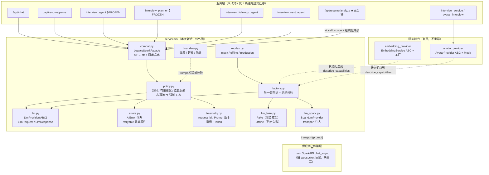

# AI 能力接入层重构报告（`services/ai/`）

> 目标：**重构 AI 能力接入层，保留现有业务接口与用户体验。**
> 原则：先取证真实调用图 → 定义窄接口 → 建工厂与运行模式 → **只迁移一条调用链** →
> 用 Fake Provider 与契约测试验证 → 其余链路通过兼容门面自动受益。
>
> 本报告所有结论均来自本仓库源码取证与实际运行的套件输出，未执行过的验证会明确标注。

---

## 0. 结论摘要

| 项 | 结论 |
|---|---|
| 真实缺口在哪 | **只有 LLM 层没有抽象**。Embedding / 数字人（含内置 ASR）在重构前**已经**是「ABC + Mock + 工厂 + 配置对象 + 错误分类」的形态，本次**复用而不重写**。 |
| 新代码位置 | `backend/services/ai/`（11 个模块，纯新增） |
| 业务核心改动 | **0 行**。5 个被源码指纹冻结的文件（`interview_agent` / `interview_core` / `interview_planner` / `interview_context` / `question_validator`）以及全部 `knowledge_*` / `vector_*` / `embedding_*` / `prompts/*` **一个字节都没动** |
| 显式迁移的调用链 | `POST /api/resume/analyze`（简历 AI 诊断）——唯一带**可控降级**的 LLM 链路 |
| 顺带受益的调用链 | `/api/chat`、`/api/resume/parse`、`interview_agent`、`interview_planner`、`interview_followup_agent`、`interview_next_agent`（经兼容门面，**零改动**） |
| 生产环境会不会静默回退 Mock | **不会**。`AI_RUN_MODE=production` 下缺凭据 / 选 fake / 未注册传输层一律**启动即抛错**（`AiModeError`） |
| 离线测试是否依赖真实密钥 | **不依赖**。`regression_env` 把 `AI_RUN_MODE` 钉成 `offline`，契约套件全 Fake |
| 契约套件 | `backend/tests/test_ai_layer.py` —— **133 项断言，EXIT=0** |
| 全量回归 | 后端 **75 套**（原 74 + 新增 1），全部通过 |

---

## 1. 重构前的真实 AI 调用图（取证，不是推测）

### 1.1 LLM（讯飞星火 X1）

```
                        ┌──────────────────────────────────────────┐
                        │ main.py:157  class SparkAPI              │
                        │  · HMAC-SHA256 签名 → wss URL            │
                        │  · _ws.create_connection(url, timeout=60)│  ← 超时硬编码
                        │  · content / reasoning_content 分开累计  │
                        │  · 失败 ⇒ 返回**字符串**，不抛异常        │
                        └──────────────────────────────────────────┘
                                        ▲
                    main.py:193  spark_api = SparkAPI()   ← 模块级单例，**无条件构造**
                                        │
   ┌────────────────────┬───────────────┼────────────────┬─────────────────────┐
   │                    │               │                │                     │
main.py:1222        main.py:1345    main.py:1406   interview_agent.py:239  interview_planner.py:568
/api/chat      /api/resume/analyze /api/resume/parse  _default_spark()      _default_spark()
   │                    │               │                │                     │
   │                    │               │      interview_followup_agent.py:326
   │                    │               │      interview_next_agent.py:289
   ▼                    ▼               ▼                ▼
 startswith("Error")  startswith(3 前缀)  正则抽 JSON      _is_spark_failure(raw)
   ← 死代码（SparkAPI 从不返回 Error 开头）
```

**失败判定靠字符串前缀**：

```python
# services/interview_agent.py:130
_SPARK_FAILURE_PREFIXES = ("API调用失败", "SparkAPI not available", "AI 回答为空")
```

**这套设计的三个具体问题**（也是本次重构的动机）：

1. **无法分类**——超时 / 鉴权失败 / 限流 / 5xx / 空响应被压成同一个前缀。
2. **无法重试**——重试策略需要"是否可重试"，字符串里没有这个信息。
3. **无法度量**——没有错误类型、没有耗时、没有 Token、没有 Prompt 版本、没有请求 ID。

### 1.2 Embedding（重构前**已经**有抽象）

```
knowledge_rag.default_embedder(role=)
        │
        ▼
embedding_provider.build_embedding_service(env)
        │  load_embedding_config(env) → EmbeddingProviderConfig
        │    ENV_PROVIDER / API_KEY / BASE_URL / MODEL / DIMENSION
        │    ENV_TIMEOUT(30s) / ENV_BATCH_SIZE(16)
        ├── hash   （默认；blake2b 词面哈希，semantic_enabled=False）
        ├── mock
        ├── openai （HttpxEmbeddingTransport，可注入）
        └── spark  （embedding_provider_spark.py：2560 维 / domain=query|para）
```

消费者：`knowledge_import_pipeline`、`knowledge_embedding_migration`、`knowledge_rag.build_vector_retriever`。

### 1.3 向量检索

```
knowledge_rag.resolve_retriever(db, retriever, use_rag)   ← 唯一开关入口
        └── vector_knowledge_retriever.VectorKnowledgeRetriever
                 └── vector_store.VectorStore(ABC) + select_matches()  ← 唯一排序口径
                          ├── vector_store_sql.SqlAlchemyVectorStore
                          └── vector_store_chroma.ChromaVectorStore
```

### 1.4 数字人 + 语音识别

```
interview_service → avatar_interview.get_provider()（进程内缓存 + reset_provider）
        └── avatar_provider.AvatarProvider(ABC) + MockAvatarProvider
                 └── avatar_provider_iflytek.build_avatar_provider(env)
                          AVATAR_PROVIDER: ""/mock ⇒ Mock；iflytek ⇒ 显式 opt-in；其它 ⇒ 启动报错
```

**语音识别没有独立 Provider**：ASR = `provider.fetch_answer`（数字人内置）。
`services/*.py` 的文件名被守卫禁止含 `asr` / `tts` / `synthes`——本次**沿用**这个约束，没有新增 ASR/TTS 抽象。

### 1.5 缺口对照表

| 能力 | 接口抽象 | 配置入口 | Mock | 超时 | 有限重试 | 指标 | 请求追踪 | Prompt/模型版本 |
|---|---|---|---|---|---|---|---|---|
| **LLM** | ❌ 无（单例硬编码） | ❌ `os.getenv` 在 `__init__` | ❌ | ⚠️ 硬编码 60s | ❌ | ❌ | ❌ | ❌ |
| Embedding | ✅ `EmbeddingService` ABC | ✅ `load_embedding_config` | ✅ `hash`/`mock` | ✅ 可配 | ❌ | ❌ | ❌ | ⚠️ 仅模型名 |
| 数字人 | ✅ `AvatarProvider` ABC | ✅ `build_avatar_provider` | ✅ `MockAvatarProvider` | ✅ `AVATAR_TIMEOUT` | ❌ | ❌ | ❌ | — |
| ASR | — 内置在数字人 | 同数字人 | ✅ | ✅ | ❌ | ❌ | ❌ | — |

**结论：只补 LLM 的抽象 + 全能力共用的横向关注点（模式 / 错误 / 指标 / 追踪 / 边界）。**
把 Embedding 和数字人重写成统一接口，是"为了重构而重构"，会打破既有守卫与契约。

---

## 2. 目标架构图



**依赖方向**：业务 → `services.ai` → 传输层。**永不反向**。
`services/ai` 顶层**不** import `main` / `knowledge_rag` / `chromadb` / `httpx` / `requests` / `aiohttp`（有 AST 守卫）。

---

## 3. 接口设计

### 3.1 为什么不是"一个 Provider 接口搞定四件事"

LLM、Embedding、语音识别、数字人的**协议与数据模型完全不同**：

| 能力 | 输入 | 输出 | 状态 | 特有字段 |
|---|---|---|---|---|
| LLM | 一段 Prompt | 一段文本 | 无状态 | Token 用量、finish_reason |
| Embedding | 一批文本 | 一批定长向量 | 无状态 | 维度、`role=query\|para` |
| 语音识别 | 音频流 | 中间/最终文本 | 流式 | 断句、置信度、超时语义 |
| 数字人 | 指令 + 文本 | 会话状态 + 音视频流 | **有状态** | 会话 id、stream_url、打断 |

合并成 `Provider.invoke(anything)` 的结果是：**每个字段只对一种能力有意义**，调用方仍要自己判断"这个字段现在有没有用"——等于把类型系统扔掉换来一个假的"统一"。

所以本层的做法是：**接口按能力分窄，横向关注点统一**。

| 能力 | 接口 | 本次动作 |
|---|---|---|
| LLM | `services/ai/llm.py::LlmProvider` | **新增** |
| Embedding | `services/embedding_provider.py::EmbeddingProvider`（既有 ABC） | **复用** |
| 数字人（含 ASR/TTS） | `services/avatar_provider.py::AvatarProvider`（既有 ABC + Mock） | **复用** |
| 统一的横向关注点 | `modes` / `errors` / `telemetry` / `boundary` | **新增** |

### 3.2 `LlmProvider` 窄接口

```python
class LlmProvider(ABC):
    name: str
    async def complete(self, request: LlmRequest) -> LlmResponse: ...   # 失败必须抛 AiError
    async def aclose(self) -> None: ...
    def describe(self) -> dict: ...
```

`LlmRequest`（不可变值对象）关键字段：

| 字段 | 用途 |
|---|---|
| `prompt` | 完整 Prompt（**必须已过边界检查**） |
| `prompt_id` | 模板标识，形如 `resume/analysis@v1` |
| `prompt_version` | 从 `prompt_id` 派生（无 `@` ⇒ `v1`） |
| `idempotent` | **能否安全重试**。默认 `True`（补全是只读调用）；`False` ⇒ 策略**强制 1 次** |
| `metadata` | 追踪字段（**禁止放 Prompt 正文 / 凭据 / 隐私**） |

`LlmResponse`：`text / provider / model / usage / latency_ms / request_id / prompt_id / prompt_version / finish_reason`。

### 3.3 供应商实现与传输层分离

`SparkLlmProvider(transport)` 只接受 `async (prompt) -> str`：

* **不重写协议**——旧 `SparkAPI` 里「HMAC 签名 + WebSocket 分帧 + X1 的 `content`/`reasoning_content` 分离」是踩过坑的代码，重写等于重踩一遍，且没有真实密钥根本测不了；
* **可测**——测试注入 Fake transport，零密钥零网络；
* **可换**——换供应商 = 换 transport 或换 Provider，业务代码零改动。

---

## 4. 三种运行模式与启动校验

| 模式 | 允许联网 | 需要凭据 | 行为 | 用途 |
|---|---|---|---|---|
| `mock` | ❌ | ❌ | 返回**固定占位文本**（明确标注 mock） | 前端联调 / 演示 / 契约测试 |
| `offline` | ❌ | ❌ | 任何调用都以 `AiUnavailableError` **确定失败** | 验证降级路径 / CI / 离线开发 |
| `production` | ✅ | ✅ | 调真实供应商 | 生产 |

`mock` 与 `offline` 都"不联网"但**语义相反**：前者假装成功（跑通 UI），后者确定失败（验证降级）。混成一个 `fake` 就无法分别测试这两条路径。

**默认口径（"不配 = 默认 = 行为不变"）**：`AI_RUN_MODE` 未配置时

* 凭据齐全 ⇒ `production`（与重构前"有凭据就真调"一致）
* 凭据不全 ⇒ `offline`（与重构前"必然失败"一致，但**不再真的去打网络**）
* **自动判定永远不会落到 `mock`**——"静默返回假数据"比"失败"严重得多，必须人工显式指定。

**启动校验**（`main.lifespan` 最前面，`_report_ai_status()`）：

| 情形 | 结果 |
|---|---|
| `production` + 缺凭据 | **抛 `AiModeError`，进程起不来** |
| `production` + 未注册传输层 | **抛 `AiModeError`** |
| `production` + `AI_LLM_PROVIDER=fake` | **抛 `AiModeError`**（显式选也不行） |
| `AI_RUN_MODE` 非法取值 | **抛 `AiModeError`**（不静默降级） |
| `mock` / `offline` | 放行，打一行摘要 |

---

## 5. 超时 / 有限重试 / 指数退避 / 错误分类

### 5.1 错误体系（`errors.py`）

| 异常 | `kind` | `retryable` | 说明 |
|---|---|---|---|
| `AiAuthError` | `auth` | **False** | 凭据错 / 过期 / 无权限 |
| `AiTimeoutError` | `timeout` | **True** | 客户端超时 / 对端无响应 |
| `AiRateLimitError` | `rate_limit` | **True** | 429 / 配额耗尽 |
| `AiUnavailableError` | `unavailable` | **True** | 连接失败 / 5xx |
| `AiResponseError` | `response` | **False** | 空 / 不可解析 / 业务错误码 |
| `AiBoundaryError` | `boundary` | **False** | Prompt 数据边界被突破 |
| `AiModeError` | `mode` | **False** | 模式非法 / 生产缺配置 |
| `AiError` | `ai_error` | **False** | 无法识别时的**保守兜底** |

`retryable` 是**类属性**，重试策略只看它，**绝不解析异常消息文本**（文案必然随厂商漂移）。
`classify_transport_error()` 对未知异常**保守归类为不可重试**——宁可少重试一次。

### 5.2 策略（`policy.py`）

| 参数 | 环境变量 | 默认 | 说明 |
|---|---|---|---|
| 单次超时 | `AI_LLM_TIMEOUT` | **90s** | 必须**大于** transport 自身超时（旧 websocket 是 60s），否则外层先放弃，拿不到更精确的失败原因 |
| 最大尝试次数 | `AI_LLM_MAX_ATTEMPTS` | **1**（不重试） | 重试是**显式 opt-in**。默认重试会把一次故障变成两倍最长等待 |
| 退避基数 | `AI_LLM_BACKOFF_BASE` | 0.5s | equal jitter，`cap = min(base·2^(n-1), 8s)` |

**三条硬规则**：

1. **默认只尝试 1 次**——重试是能力，不是默认行为。
2. **只重试 `retryable` 的错误**——鉴权失败重试一万次也还是错的。
3. **非幂等请求恒为 1 次**——`LlmRequest.idempotent=False` ⇒ `attempts_for()` 直接返回 1，`AI_LLM_MAX_ATTEMPTS` 写得再大也没用（有断言覆盖）。

**退避用 equal jitter**：`delay = cap·(1-ratio) + cap·ratio·rand`。纯指数会让所有实例同一时刻重试（惊群），纯随机又可能退避过短。

---

## 6. 追踪 / 指标 / Prompt 版本 / Token

```python
with ai_call_scope("resume/analysis@v1") as scope:
    text = await spark_api.chat_async(prompt)
# scope.request_id / scope.provider / scope.error / scope.response / scope.attempts
```

* **作用域自动继承**：`call_llm` 从 contextvar 读 `prompt_id` 与 `scope`，调用方**不必逐层透传参数**；
* **`request_id`** 贯穿日志、错误对象、`LlmResponse`、以及 `/api/resume/analyze` 的响应体；
* **指标键集是固定闭集（8 键）**：`ai_calls_total` / `ai_errors_total` / `ai_retries_total` / `ai_timeouts_total` / `ai_latency_ms_total` / `ai_tokens_prompt_total` / `ai_tokens_completion_total` / `ai_boundary_blocks_total`，未登记的名字**被忽略**（键集不会悄悄漂移）；
* **Token 用量**：供应商不返回时保持 0 且 `estimated=False`，**不猜**（旧星火 transport 就不返回用量）；
* **结构化日志**：一行一条 JSON（`ai_call_ok` / `ai_call_retry` / `ai_call_failed`），**不含 Prompt 正文与凭据**。

**为什么没挂到 `/api/health`**：`metrics` 已被既有契约断言为**固定 12 键**，加键等于破坏契约。指标通过 `telemetry.snapshot()` 与 `describe_capabilities()` 暴露，**不动 health 契约**。

---

## 7. 数据边界

| 防线 | 实现 | 断言 |
|---|---|---|
| 越权注入（A 用户塞进 B 用户的简历） | `ensure_owner(record_owner, actor_id)`；归属唯一可信来源是 `resume.user_id` | 不一致 ⇒ `AiBoundaryError` |
| 无关数据注入（整表 / 整对象） | `PromptBoundary.max_chars`（默认 20000） | 超限 ⇒ **拒绝，不截断**（截断会静默丢数据） |
| 指定标识符混入 | `PromptBoundary.forbidden` | 出现即拒绝，**报错不回显 token 本身**（回显等于二次泄露） |
| 敏感信息外泄 | `scrub_contact_info()`（手机号 / 邮箱 / 身份证） | 脱敏后仍超长或仍含禁注入标识符 ⇒ 依旧拒绝 |
| 兜底 | `SparkLlmProvider` 自身再查一次长度 | 即使调用方漏检也不发出去 |

---

## 8. 迁移的调用链与兼容策略

### 8.1 显式迁移：`POST /api/resume/analyze`（简历 AI 诊断）

选它的理由：**全项目唯一带可控降级的 LLM 链路**（`_fallback_diagnosis()` 用规则引擎维度分兜底），正好覆盖"Provider 故障时有明确错误和降级行为"这条验收标准。

改动（`main.py`）：

```python
# 之前：无追踪、无版本、失败只按前缀猜
try:
    chat_answer = await spark_api.chat_async(prompt)
except Exception:
    chat_answer = ""

# 之后：声明 Prompt 版本 + 拿结构化失败原因
with ai_call_scope("resume/analysis@v1") as scope:
    try:
        chat_answer = await spark_api.chat_async(prompt)
    except Exception:
        chat_answer = ""

if scope.error is not None:                 # ① 结构化原因（超时/鉴权/限流/不可用）
    ai_available = False
    ai_error = scope.error_dict()
if len(raw_answer.strip()) < 10 or raw_answer.startswith(旧前缀):   # ② 旧哨兵兜底
    ai_available = False
    chat_answer = _fallback_diagnosis()
```

响应体新增**一个附加字段** `ai_error`（成功时为 `None`），旧客户端不读即可，行为不变。

### 8.2 兼容门面：其余 7 个调用点**零改动**

`main.spark_api` 从 `SparkAPI()` 换成 `LegacySparkFacade()`：

```
spark_api.chat_async(prompt)  →  门面  →  模式 → Provider → 策略 → 指标/追踪
                                        ↓
                            失败时渲染回**旧哨兵串**（逐字沿用）
```

**哨兵映射表**（前缀必须落在 `LEGACY_FAILURE_PREFIXES` 内）：

| 内部错误 | 对外字符串 |
|---|---|
| `AiTimeoutError` | `API调用失败: 请求超时` |
| `AiAuthError` | `API调用失败: 鉴权失败` |
| `AiRateLimitError` | `API调用失败: 供应商限流` |
| `AiUnavailableError` | `API调用失败: 服务不可用` |
| `AiResponseError` | `AI 回答为空` |
| `AiModeError`（未配置 / 非法） | `SparkAPI not available` |
| 其它 | `API调用失败: <kind>` |

因此冻结文件的 `_is_spark_failure()` 判定、以及既有测试对哨兵串的断言**全部不变**（有断言覆盖：六种渲染结果逐个喂给 `interview_agent._is_spark_failure` 必须返回 `True`）。

---

## 9. 修改文件清单

### 9.1 新增（12 个文件）

| 文件 | 行数量级 | 职责 |
|---|---|---|
| `backend/services/ai/__init__.py` | ~150 | 公开 API 收口 |
| `backend/services/ai/errors.py` | ~210 | 错误体系 + 分类 + 旧哨兵前缀 |
| `backend/services/ai/modes.py` | ~160 | mock/offline/production + 启动校验 |
| `backend/services/ai/llm.py` | ~150 | `LlmProvider` ABC + 值对象 |
| `backend/services/ai/llm_fake.py` | ~160 | Fake（假装成功）/ Offline（确定失败） |
| `backend/services/ai/llm_spark.py` | ~150 | 星火 Provider（transport 注入） |
| `backend/services/ai/policy.py` | ~250 | 超时 / 有限重试 / 指数退避 |
| `backend/services/ai/telemetry.py` | ~230 | 追踪 / 指标 / Prompt 版本 |
| `backend/services/ai/boundary.py` | ~150 | Prompt 数据边界 |
| `backend/services/ai/factory.py` | ~250 | 唯一装配点 + `describe_*` + 启动校验 |
| `backend/services/ai/compat.py` | ~150 | 旧字符串契约门面 |
| `backend/tests/test_ai_layer.py` | ~680 | 契约自检（133 项断言） |

### 9.2 修改（4 个文件，均为小范围）

| 文件 | 改动 |
|---|---|
| `backend/main.py` | ① `spark_api = SparkAPI()` → 注册 transport + `build_legacy_spark_facade()`；② `/api/resume/analyze` 加 `ai_call_scope` + 结构化降级 + `ai_error` 字段；③ `lifespan` 最前面加 `_report_ai_status()` |
| `backend/tests/regression_env.py` | `PINNED` 新增 5 键：`AI_RUN_MODE="offline"`（★非空）、`AI_LLM_PROVIDER` / `AI_LLM_TIMEOUT` / `AI_LLM_MAX_ATTEMPTS` / `AI_LLM_BACKOFF_BASE` 空串 |
| `.github/workflows/ci.yml` | 头部注释 74 → 75 套 |
| `PRODUCTION_CHECKLIST.md` | 新增 AI 接入层配置项与验收清单 |

### 9.3 明确**未**改动（这是本方案的核心约束）

| 类别 | 文件 |
|---|---|
| 源码指纹冻结（`FROZEN_SOURCES`） | `interview_agent.py`、`interview_core.py`、`interview_planner.py`、`interview_context.py`、`question_validator.py`、`prompts/interview/question*.txt` |
| 检索 / 向量 / Embedding（同样被指纹锁） | `knowledge_retriever.py`、`vector_knowledge_retriever.py`、`vector_store*.py`、`embedding_service.py`、`embedding_provider.py` |
| 其它业务模块 | `interview_service.py`、`interview_orchestrator.py`、`api/interview.py`、`api/interview_ws.py`、`avatar_*`、`knowledge_*` |

`test_ai_layer.py [10]` 用 **AST**（不是子串）断言这 5 个冻结文件**没有** import `services.ai`——证明本次是"外围新增"，不是"核心改写"。

---

## 10. 兼容性说明

### 10.1 API 契约

| 契约 | 状态 |
|---|---|
| `POST /api/resume/analyze` 请求 / 响应 | **向后兼容**（只新增 `ai_error` 字段，其余逐字不变） |
| `POST /api/chat` / `/api/resume/parse` | **完全不变**（未改动，经门面） |
| `spark_api.chat_async(prompt) -> str` | **语义不变**（成功返文本，失败返旧哨兵串，**绝不抛异常**） |
| 路由总数 | **31，未变**（未新增任何路由） |
| `/api/health` | **未变**（`metrics` 仍是固定 12 键，未新增键） |

### 10.2 行为差异（都是改进，逐条列出）

| # | 差异 | 影响 | 风险评估 |
|---|---|---|---|
| 1 | 无凭据时不再**真的去打网络**，直接判定 offline | 失败更快（原来要等 60s 超时） | 无风险：失败判定结果相同 |
| 2 | 失败原因从"一段拼接文案"变成**结构化分类** | `/api/resume/analyze` 的 `ai_error` 可区分故障类型 | 无风险：旧字段语义未变 |
| 3 | 单次调用有**外层超时**（90s） | 卡死的连接不会无限挂住 | 无风险：transport 自身 60s 超时先触发 |
| 4 | 默认**不重试**（`max_attempts=1`） | 与重构前行为一致 | 无风险：想重试需显式配 `AI_LLM_MAX_ATTEMPTS` |
| 5 | 启动期新增 AI 配置校验 | 生产配错时**进程起不来** | **有意的破坏性变更**（fail-closed）；本地/CI 不受影响 |
| 6 | 回归套件钉扎 `AI_RUN_MODE=offline` | 套件与真实密钥彻底解耦 | 无风险：三模式由 `test_ai_layer` 显式覆盖 |

### 10.3 已知限制（未解决，明确记录）

1. **Token 用量恒为 0**——旧星火 transport 不返回用量，本层**不猜**（`estimated=False`）。要拿到真实用量得改 `SparkAPI.chat()` 的返回值形状，属于协议层改动，本次不做。
2. **超时后线程不会立刻结束**——`SparkAPI.chat()` 跑在 `run_in_executor` 的线程里，`asyncio.wait_for` 取消的是 await，杀不掉线程；线程会一直阻塞到它自己的 60s websocket 超时。这是旧实现的固有限制，需要改协议层才能真正解决。
3. **指标只在进程内**——多 worker 时各进程独立计数。与 `utils/login_throttle` 同一取舍；要聚合需外置（本次不做）。
4. **`/api/chat` 有一处死代码**（审计发现，**未修**）：`main.py` 里 `if ai_response.startswith("Error")` 永远不会命中——`SparkAPI` 的失败文案是 `API调用失败: ...`，不是 `Error` 开头。属于既有缺陷，按"不顺手做无关重构"的约定只在报告中记录，建议后续单独修。
5. **未接入真实供应商的联网验证**——`SparkLlmProvider` 的真实链路需要密钥，本次只有 Fake transport 的契约验证；联网验证在 `tests/*_run.py`（不进回归循环）。

---

## 11. 测试报告

### 11.1 新增契约套件 `backend/tests/test_ai_layer.py`

**零密钥、零网络**：所有 Provider 都是 Fake，所有等待都是注入的"零等待"。

| 节 | 覆盖内容 | 断言数 |
|---|---|---|
| [1] | 模式解析（自动判定 / 显式 / 非法值报错 / `describe_run_mode` 不抛） | 9 |
| [2] | **生产模式不静默回退**（缺凭据 / 未注册传输层 / 显式 fake / 未知 provider） | 7 |
| [3] | 错误分类（8 个类的 `kind`/`retryable` + 传输异常归类 + 幂等） | 14 |
| [4] | 超时 / 有限重试 / 指数退避（含封顶、jitter 两端、鉴权不重试、重试耗尽） | 12 |
| [5] | **非幂等不盲目重试**（配置 5 次也只跑 1 次） | 3 |
| [6] | 追踪 / Prompt 版本 / 指标闭集 / Token 用量 / 结构化失败原因 | 18 |
| [7] | 数据边界（超长 / 禁注入标识符 / 归属 / 脱敏） | 10 |
| [8] | 旧字符串契约（6 种渲染 × 3 断言 + 4 种旧哨兵识别 + 门面绝不抛） | 25 |
| [9] | **契约测试：注入 Fake/Offline/第三个 Provider，冻结的 `interview_agent` 零改动** | 8 |
| [10] | AST 守卫（冻结文件不 import `services.ai`；`services/ai` 顶层无禁忌依赖） | 21 |
| [11] | `describe_llm` / `describe_capabilities` / `validate_startup` 永不抛 | 6 |

**结果：133 项断言全部通过，EXIT=0。**

关键断言（对应验收标准）：

* ★ `冻结的 interview_agent 用新 Provider 正常出题` —— 换 Provider **不需要**改业务核心；
* ★ `换 Offline Provider ⇒ ok=False 且 question 为空（不伪造）` —— 故障时有明确错误与降级；
* ★ `非幂等调用只尝试一次（即使错误本身可重试）` —— 非幂等不盲目重试；
* ★ `production 缺凭据 / 显式选 fake / 未注册传输层 ⇒ AiModeError` —— 生产不静默回退 Mock；
* ★ `旧判定仍认它是失败` ×6 —— 旧契约无破坏。

### 11.2 回归

| 套件 | 结果 |
|---|---|
| 后端 SQLite 自检 | **75 套 / 全部通过**（原 74 + 新增 `test_ai_layer`） |
| 受影响最直接的 `test_analyze_endpoint` | 全部通过（含"LLM 不可用 ⇒ 降级、不把原始错误串当诊断结果"） |
| 前端自检 | 未改动前端，未运行（本次无前端变更） |
| 真实 MySQL 运行器（`tests/*_run.py`） | 未改动数据库层，未运行（本次无 DB 变更） |

---

## 12. 后续建议（按优先级）

1. **把 `/api/chat` 与 `/api/resume/parse` 显式迁到类型化接口**——它们现在经门面已具备超时/追踪，但仍靠前缀判失败（`/api/chat` 那处前缀还是错的）。
2. **`/api/chat` 的死代码**单独修一次（`startswith("Error")` → 走 `_is_spark_failure`）。
3. **给 Embedding / 数字人补上"有限重试 + 指标"**——接口已就绪，缺的是 `policy` 与 `telemetry` 的接入（同样另起组装模块，不动既有 ABC）。
4. **Token 用量**：改 `SparkAPI.chat()` 让 transport 返回 `(text, usage)`，本层已预留 `LlmUsage.estimated`。
5. **指标外置**：多 worker 场景需要聚合时，把 `MetricsRegistry` 换成外置实现（接口已经收敛在 `telemetry`）。
